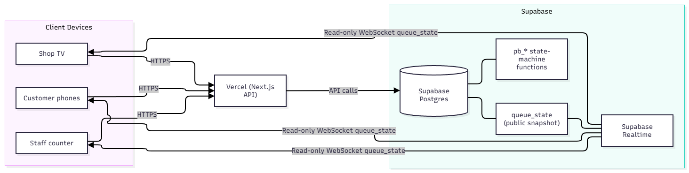

# Photobooth Queue System

> English is the default documentation language. See the [Vietnamese README](./README.vi.md).

A single web app for photobooth shops with three realtime views sharing the same queue data:

| View | URL | Users |
|---|---|---|
| Customer | `/s/{slug}` (and `/` redirects to the default shop), then `/t/{token}` | Customers on phones. One link lets them take a number and track the queue. |
| Staff counter | `/staff` (`/staff/settings` for settings, `/staff/print` for QR printing) | Staff and shop owners |
| Shop display | `/display/{slug}?key=…` | The shop TV |

**Stack:** Next.js 16 (App Router, strict TypeScript) + Tailwind, deployed on **Vercel**. Database: **Supabase** (Postgres 17) with **Supabase Realtime**.

## 1. Architecture

### Architecture diagram



- Queue business rules live in PostgreSQL functions in `supabase/migrations/`: `pb_create_ticket`, `pb_staff_action` (Next / No-show / Recall / Cancel / Undo), `pb_set_code`, `pb_set_paused`, and others. Each function runs in one transaction and locks `daily_sessions` with `FOR UPDATE`, so ticket numbers remain sequential and unique under concurrent requests.
- After every mutation, `pb_refresh_state` writes a public snapshot to `queue_state`. It contains the serving number, waiting queue, missed numbers, average service time, and `version`, but no names, phone numbers, or daily codes.
- Browsers subscribe to `queue_state` through Supabase Realtime on `shop:{shopId}`. The anon key and RLS allow read access only to this table. Customers calculate their remaining turns from the snapshot and their own ticket.
- If Realtime is unavailable, clients poll every 15 seconds; while connected, they still poll once per minute. Tabs and network connections refresh immediately when restored. Older snapshots are ignored by `version`.
- Next.js APIs use the service-role key only on the server. All other tables have RLS enabled and do not grant anon access.

```
src/
  app/            pages and API routes
  components/     ui/, customer/, staff/, display/
  lib/            database, auth, rate limiting, validation, queue state
supabase/
  migrations/     schema and SQL state machine
  seed.sql        demo data
tests/            Vitest state-machine, concurrency, and position tests
e2e/              Playwright customer → staff → display flow
```

## 2. Run locally

Requirements: Node 20+ and Docker Desktop for local Supabase.

```bash
npm install
npx supabase start
npx supabase db reset
npx supabase status -o env
cp .env.example .env.local
npm run dev                 # http://localhost:3000
```

Fill `.env.local` with the keys from `supabase status` and
`NEXT_PUBLIC_SUPABASE_URL=http://127.0.0.1:54321`.

Demo data:

| View | URL / credentials |
|---|---|
| Customer | http://localhost:3000 → `/s/demo-photobooth`, daily code `1234` |
| Staff | http://localhost:3000/staff, `owner` / `owner123` or `staff` / `staff123` |
| Shop display | http://localhost:3000/display/demo-photobooth?key=demo-display-key |
| Sample tickets | Tickets 1–12, including served, missed, serving, cancelled, and waiting examples. Try `/t/demo-token-12`. |

### Tests

```bash
npm test
npm run build && npx playwright install chromium && npm run test:e2e
```

Both test suites require `npx supabase start`. Tests create their own shop and do not modify the demo data. The unit suite covers the state machine, grace periods, undo, idempotency, duplicate phone numbers, pausing, daily reset, and 50 concurrent ticket requests.

## 3. Environment variables

| Variable | Required | Description |
|---|---:|---|
| `NEXT_PUBLIC_SUPABASE_URL` | Yes | Supabase project URL |
| `NEXT_PUBLIC_SUPABASE_ANON_KEY` | Yes | Public anon key, used only for Realtime |
| `SUPABASE_SERVICE_ROLE_KEY` | Yes | Secret service-role key; store it only on Vercel |
| `NEXT_PUBLIC_DEFAULT_SHOP_SLUG` | No | Shop opened at `/`; defaults to `demo-photobooth` |
| `NEXT_PUBLIC_APP_URL` | No | Public URL used for printed QR codes; falls back to the current domain |
| `LOG_LEVEL` | No | `info` (production default) or `debug` |
| `DATABASE_URL_TEST` | No | Used only for local tests |

## 4. Deploy with Supabase and Vercel

### 4.1 Supabase

1. Create a project at [supabase.com](https://supabase.com), preferably in Singapore (`ap-southeast-1`) for Vietnam-based shops.
2. Push the schema:

   ```bash
   npx supabase login
   npx supabase link --project-ref <project-ref>
   npx supabase db push
   ```

3. Create a shop and owner account in the SQL Editor. Replace the shop name, slug, and password:

   ```sql
   with s as (
     insert into public.shops (slug, name)
     values ('shop-slug', 'My Photobooth Shop')
     returning id
   )
   insert into public.staff_users
     (shop_id, username, display_name, password_hash, role)
   select id, 'owner', 'Shop owner',
     extensions.crypt('USE-A-STRONG-PASSWORD', extensions.gen_salt('bf', 10)),
     'OWNER'
   from s;
   ```

   To use demo data, run `supabase/seed.sql` instead.
4. In **Project Settings → API**, copy the project URL, anon key, and service-role key.

### 4.2 Vercel

1. Push the repository to GitHub and import it into Vercel as a Next.js project.
2. Add the environment variables from section 3 to Production and Preview. Set `NEXT_PUBLIC_DEFAULT_SHOP_SLUG` to the shop slug.
3. Deploy. `vercel.json` selects the Singapore region (`sin1`) to stay close to the database.
4. Optionally add a custom domain under **Settings → Domains**. Vercel provides HTTPS automatically.
5. After deployment, sign in at `/staff` and use **Settings** to configure the shop and change the password.

> **Plan limits:** Vercel Hobby is not for commercial use; commercial shops should use Pro. Supabase Free supports up to 200 simultaneous Realtime connections and may pause an inactive project after seven days. Clients fall back to 15-second polling when the connection limit is exceeded.

## 5. Print QR codes and set up the TV

**QR at the counter:** Open **Settings → Print A5 QR** (or `/staff/print`), print on A5 paper. The sheet includes the logo, customer URL, and three steps: scan the code, enter the daily code shown on screen, and get a number. The QR URL is stable, so it does not need to be reprinted when the daily code changes.

**Shop TV:**

1. Copy the **Shop display link** from **Settings**. It contains a secret `key`; do not share it.
2. Open it in Chrome on a smart TV, Android box, or mini PC. Use the fullscreen button or F11.
3. Touch or click the screen once to allow the browser to play the notification sound. Use the volume button to toggle it.
4. Wake Lock prevents the screen from sleeping where supported. Disable the TV's own power-saving mode if necessary. If the connection is unavailable for more than 30 seconds, the page reloads when the network returns.
5. If the link may have been exposed, choose **Create new display key** in Settings. The old link becomes invalid.

## 6. Business rules and assumptions

- Business dates use the shop timezone (`Asia/Ho_Chi_Minh`) and reset time (00:00 by default). Numbers restart at 1 after reset; the next request creates the new daily session.
- **Daily code:** automatic mode generates a new code each day. Manual mode keeps the code until staff changes it. Automatic rotation every N hours is checked on access, and the TV checks every 60 seconds.
- **Grace period:** the default is two turns. A missed ticket at turn k can be recalled until two other tickets have been called. On the third call it becomes **Expired**. Calls made while nobody is being served do not count.
- **Recall:** a recalled ticket is placed next, without interrupting the current serving ticket. If nobody is serving, it is called immediately. Staff decide whether another grace period applies after a second no-show.
- **Undo:** only the most recent Next / No-show / Recall action can be undone within 60 seconds, and only if no later queue-changing action occurred. Cancellation cannot be undone.
- **Duplicate phone numbers:** if a phone number already has a waiting, serving, or missed ticket that day, the old ticket is returned. Completed, expired, and cancelled tickets can receive a new number. Anyone who knows the phone number and daily code can access that ticket; this is the trade-off for phone-number lookup.
- Customers can cancel only waiting or missed tickets, not a serving ticket.
- Pausing ticket intake blocks customer self-service but still allows staff to add customers manually.
- Manual tickets do not require the daily code and may omit a phone number. The display shows a large number and QR code; thermal receipt printing is not supported.
- Estimated waiting time is turns ahead multiplied by today's average service time. Only services lasting 30 seconds to 3 hours count, and at least two completed services are required; otherwise the configured default (10 minutes) is used.
- Rate limits are stored in Postgres and shared by all serverless instances: wrong daily code 5 times per 10 minutes per IP and device, 30 times per 10 minutes per IP; ticket creation and lookup 60 times per 10 minutes per IP; failed login 10 times per 10 minutes.
- Security measures include 192-bit ticket tokens, bcrypt passwords, `httpOnly`, `SameSite=Lax`, and `Secure` session cookies, hashed session tokens, Origin-based CSRF checks, CSP, `X-Frame-Options`, and `nosniff`. Phone numbers are deleted after 30 days by default.
- Every table is scoped by `shop_id`; staff usernames are unique globally. Tickets already have an optional `station_id` for future multi-room support.

## 7. Feature status

The implementation includes the three shared realtime views, sequential concurrent-safe numbering, the full ticket state machine, grace periods and undo, phone lookup and cancellation, staff roles and idempotent actions, display-board audio and Wake Lock, settings, A5 QR printing, CSV export, REST APIs with Zod validation, structured logging, unit tests, Playwright E2E tests, and demo seed data.

The following design choices replaced the original plan:

| Original plan | Current implementation |
|---|---|
| SSE stream with `LISTEN/NOTIFY` | Supabase Realtime, because Vercel serverless functions cannot keep long-lived SSE connections |
| PostgreSQL 16 + Prisma | Supabase Postgres 17 with SQL migrations and database functions |
| Docker, Nginx, and Let's Encrypt deployment | Vercel deployment; Docker is used only for local Supabase |
| Full shadcn/ui installation | Small custom components following the shadcn style |
| Offline service worker | PWA manifest and icon only; offline mode is not needed for “Add to home screen” |

Out of scope: reservations, deposits, Zalo ZNS/SMS, and multiple photo rooms. The `station_id` column is already available for future multi-room support.
